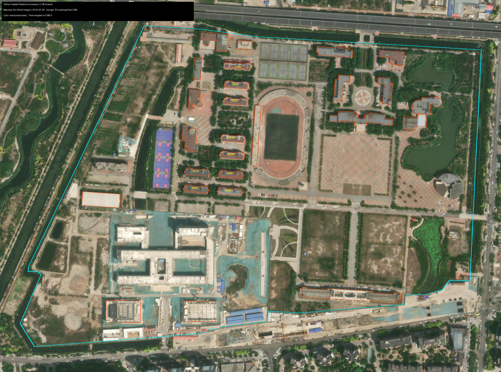
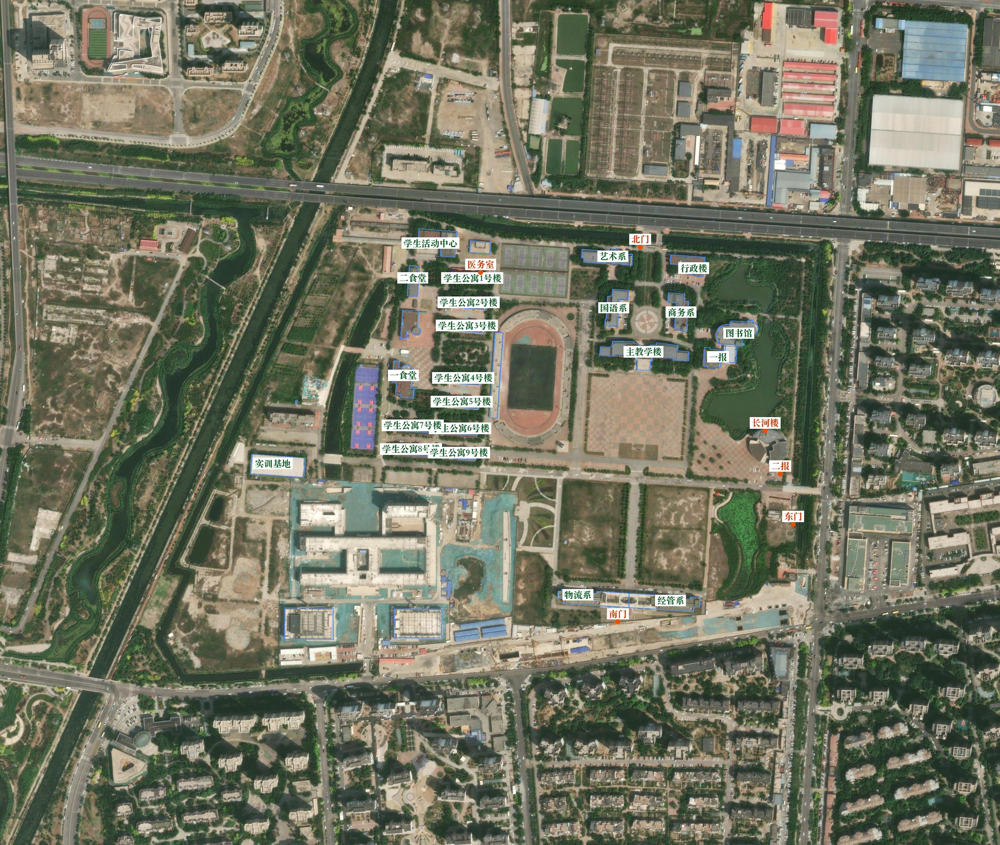

# 校园植物地图 · 天津滨海职业学院

把校园地图做成一个能点、能加、能多人同时记录的植物档案工具。
学生带着手机在校园里边走边记，老师在电脑上看着标记一个个冒出来。

**老校区纪念版** —— 学校正在建新校区（黄港，2027 年竣工），
这个项目把老校区的植物记录下来留个念想。



---

## 为什么做这个

学校要做校园植物的信息化，但**公开数据里一棵植物都没有**。

查了 OpenStreetMap，整个校园的植物记录数是 **0** —— 只能靠人一棵棵录。
所以做了这个工具：在地图上点一下就能记一株（位置、种类、数量、照片），
几十个学生分头记录，数据自动汇总，不用收文件再手工合并。

---

## 学生怎么记录

手机浏览器打开网址就行，**不用装 App，不用注册**。

**用手机流量也可以** —— 网页部署在腾讯云开发上，
不要求学生连校园网，也不要求老师一直开着电脑。

第一次打开会让你**登记一个名字和暗号**（比如"张三"和一个自己设的 4 位数字）。
这不是实名认证，用途只是"分清谁记的"——记录归到你名下，
换手机、清缓存都还找得回来。暗号只存 md5，别人读不到。

### 记录流程

**走到植物旁边再点，不要对着几十米外的树估位置。**

1. 站到植物旁边，等地图上的蓝点稳定（手机定位会漂几米，等一下更准）
2. 点底部「＋ 记录身边的植物」——用你当前位置
3. 选种类。按学校自己发的《校园植物名录》分成四类，**共 70 种**
   （乔木 39、灌木或藤木 25、草本 5、竹类 1）。
   面板默认只展开「乔木」，其他三类点标题展开；也可以直接在搜索框打名字
4. 照着表格填。**不同类别填的东西不一样**（表格自己变）：

   | 类别 | 要填的 |
   |---|---|
   | 乔木 | 胸径、树高、**株数** |
   | 灌木或藤木 | **株数** |
   | 草本 | **面积**（平方米） |
   | 竹类 | **丛数** |

5. 拍张照片。照片是认定种类最有力的证据
6. 备注写点只有现场才知道的：靠哪栋楼、有没有长椅

### 几个实用提示

- **成片同种的可以合并成一条**（一排行道树、一片绿篱），填总量，不用一棵一棵点
- **数不清就点「若干」** —— 给"一整片绿篱""一丛竹子"准备的。
  标了之后统计时不会并进总数，会单独注明"另有 N 处若干"，
  汇报时不会被误读。硬编一个数字反而是假数据
- **完全认不出来就点「暂不确定」**，先记位置，回头查了再补。
  **位置比种名重要**——名字可以后补，位置补不了
- **两株挨得很近也能分开记**。处在"正在选点"状态时，
  点到别人的标记就是**在这个位置记一株新的**，用的是你实际点的位置
- 记录**立刻存到手机本地**，关掉网页、断网都不会丢

### 权限分三级

| 身份 | 能做什么 |
|---|---|
| 学生 | 记自己的、改删自己名下的 |
| 老师 | 能改删任何记录，还能管成员名单 |
| 访客（没登记） | 只能看 |

---

## 老师怎么把网页跑起来

三种方式，按情况选。

### 一、云端部署（推荐，现在是主要用法）

线上地址：

```
https://campus-tree-map-d9fro6lv4b0094f8-1309202203.tcloudbaseapp.com/web/
```

网页是纯前端静态页面，托管在腾讯云开发的静态托管。
数据库用云开发的 PostgreSQL，配置在 `web/app.js` 开头的 `CLOUD_ENV`。

学生打开同一个网址就能一起记录，不用连校园网。

**改完代码要传上去**：本地改完只推 GitHub 是不生效的，
得把 `web/` 下的文件传到静态托管，学生才看得到。
步骤见 `web/使用说明.md` 的「怎么更新线上」。

### 二、本机起服务（局域网协作）

```bash
python3 web/server.py
```

会打印一个局域网地址，发到班级群里，学生连同一个 WiFi 就能记录。
需要电脑上装了 Python。

### 三、打包成双击就能用的程序（一般用不到）

```bash
sh launcher/build.sh      # 需要 Go 工具链
```

生成的压缩包解压后双击就能用（macOS 和 Windows 各一个）。

**现在默认不发了** —— 线上网址在手机上更省事，学生不用装东西。
只有确实需要离线运行时才打这个包。

---

## 功能

**平面地图** —— 卫星影像 + 建筑轮廓，看得清地面细节，适合实地记录

**三维视图** —— 30 栋楼按估算层数立起来，可旋转倾斜；适合汇报展示
- 🔄 **环绕**：相机自动绕校园转一圈（约 100 秒），投大屏时不用手拖
- 🔍 **筛选**：按种类筛选，没选中的变暗保留
  （不直接隐藏，避免误以为那片没记录）

**实时协作** —— 谁记了什么，其他人十几秒内自动看到，不用刷新页面。
一个人删掉某条，别人的地图上也会同步消失

**多人合并** —— 两个人记了同一株，系统按 GPS 距离（15 米内）自动识别并提示，
由人决定是合并、都保留还是丢弃。**类别不同就一定不算重复**

**导出** —— CSV 交给老师（Excel 打开不乱码）、JSON 备份（含照片）

**统计** —— 按类别分组看构成和总量，条形图直接截屏就能汇报

---

## 关于底图的一个说明

底图用的是 Esri 卫星影像，拍摄日期 **2025-05-20**。

有人会问为什么不用更新的。核实过：**这是这块地能拿到的最新影像**。
把当前版本和 Esri 的历史版本存档逐像素比对，2026 年的三次更新
在这块地都是同一张图（像素差为 0.00）。

国内地图源（如高德）的影像确实更近，但那张是落叶季拍的，
**树上看不见树冠** —— 对一个"数树"的项目来说，这个代价太大。

详见 `analysis/scripts/README.md` 里的核实记录。

---

## 数据来源

| 内容 | 来源 | 说明 |
|---|---|---|
| 卫星底图 | Esri World Imagery | 2025-05-20 拍摄，0.34 m/px |
| 建筑轮廓 | OpenStreetMap | ODbL 1.0，使用时需署名 |
| **建筑名称** | 学校提供的规划鸟瞰效果图 | 图上用红字标注，提取后配准到经纬度 |
| **10 号公寓轮廓** | 师生实地测绘 | 到楼下实测四个屋角 |
| 植物名录 | 学校《校园植物名录（26年10月）》 | 70 种 |
| 记录数据 | 师生实地记录 | — |

**建筑名称是怎么来的**：学校给的是一张透视效果图，上面的楼名是红字。
先把红字位置提取出来，用单应变换配准到真实经纬度
（配准残差 0.7～38 px，约合 0.3～18 m），再取最近的 OSM 建筑。
配不准的不硬套，宁可留空。



上图左边是学校给的效果图，右边是真实卫星影像，同一栋楼一一对上。

**坐标系**：项目内部统一用 WGS-84。如果要接入高德/百度底图，
必须做坐标转换（GCJ-02 偏移约 90 米），否则标记会跑到马路对面。

---

## 目录结构

```
web/                  网页应用（纯前端静态页面）
├── index.html
├── app.js              平面视图 + 数据管理 + 云端协作
├── view3d.js           三维视图（MapLibre GL）
├── server.py           局域网协作服务器（只用 Python 标准库）
├── campus.json         校园矢量数据（29 栋建筑，带估算高度）
├── species.json        物种库（70 种）
├── tiles/              离线地图瓦片 z17-z19，共 546 张
└── vendor/             Leaflet + MapLibre GL + CloudBase SDK

launcher/             一键启动器
├── main.go             Go 写的服务（把整个网页打包进单个可执行文件）
├── build.sh            一次生成 macOS 和 Windows 两个版本
└── accept.sh           自动验收脚本

analysis/scripts/     数据获取与分析
├── fetch_osm_campus.py        从 OpenStreetMap 拉校园矢量数据
├── build_campus_3d.py         生成建筑高度估算和底图
├── build_web_assets.py        生成网页用的数据文件（含规划图配准）
├── detect_missing_buildings.py 找出漏标的建筑
└── extract_render_labels.py   从规划效果图抠红色标注

data/raw/osm/         原始数据（校园边界、建筑、道路、水体）
data/raw/plan/        学校规划效果图
data/processed/       处理后数据（带高度的建筑体块）

figures/              成果图
results/reports/      可行性调研报告
```

---

## 技术选型说明

**为什么用 Go 写启动器**：Python 的打包工具必须在 Windows 上才能生成
Windows 程序，而 Go 可以直接在 Mac 上交叉编译。一次生成两个平台。

**为什么地图瓦片要放在本地**：学生在校园里用，不能假设有稳定网络。
整个应用零外部依赖。

**为什么两个渲染库并存**：Leaflet 做平面（轻快、手机上跟手），
MapLibre GL 做三维（WebGL 渲染建筑体块）。两者共用同一份数据。

**为什么云端轮询是 15 秒**：每问一次数据库都算一次调用，
而数据库算力是云开发资源点的大头（实测占九成）。
15 秒足够及时，消耗只有 5 秒的三分之一。

**踩过的坑**（详见 `web/使用说明.md`）：
- 三维视图不能用 symbol 文字图层 —— 它要加载远程字体，字体拉不到时
  会连带把整个数据源的渲染卡住
- 建筑高度是估算的。OSM 里没有真实高度数据，按楼层数推算，
  每栋都标注了推算依据

---

## 版本

| 版本 | 内容 |
|---|---|
| **v1.6** | 10 号公寓补上实测轮廓，三维里立起来了 |
| **v1.5** | 照片可以从相册选了；补一道防「无归属记录」的硬检查 |
| **v1.4** | 接入腾讯云开发（学生用流量也能协作）；草本可以圈范围；按实名认人 |
| **v1.3** | 按《校园植物名录》的列结构，四类各记各的字段 |
| **v1.2** | 收紧默认视野，修复相邻植株记不下的问题 |
| **v1.1** | 加入规划图建筑名称，物种库换成学校官方名录 |
| **v1.0.1** | 加入版本发布脚本 |
| **v1.0** | 首个完整版本：平面地图、三维视图、实时协作、多人合并、一键启动器 |

### 发新版本

改完代码后，一条命令：

```bash
sh release.sh v1.6 "这次改了什么"
```

它会自动：提交改动 → 打标签 → 推送代码和标签，然后提示建 Release。

版本号用 `v主.次` 的格式：加了新功能升次版号，大改动升主版号。
Release 说明会自动从提交记录汇总，所以**提交信息写清楚一点**，
Release 页面就好看。

---

## 关于

天津滨海职业学院（Tianjin Coastal Polytechnic）老校区植物记录项目。

校园约 **53.8 公顷（807 亩）**，29 栋建筑，建筑密度 7.7%。
按一般高校绿地密度估算，乔木可能 2000～5000 株。
